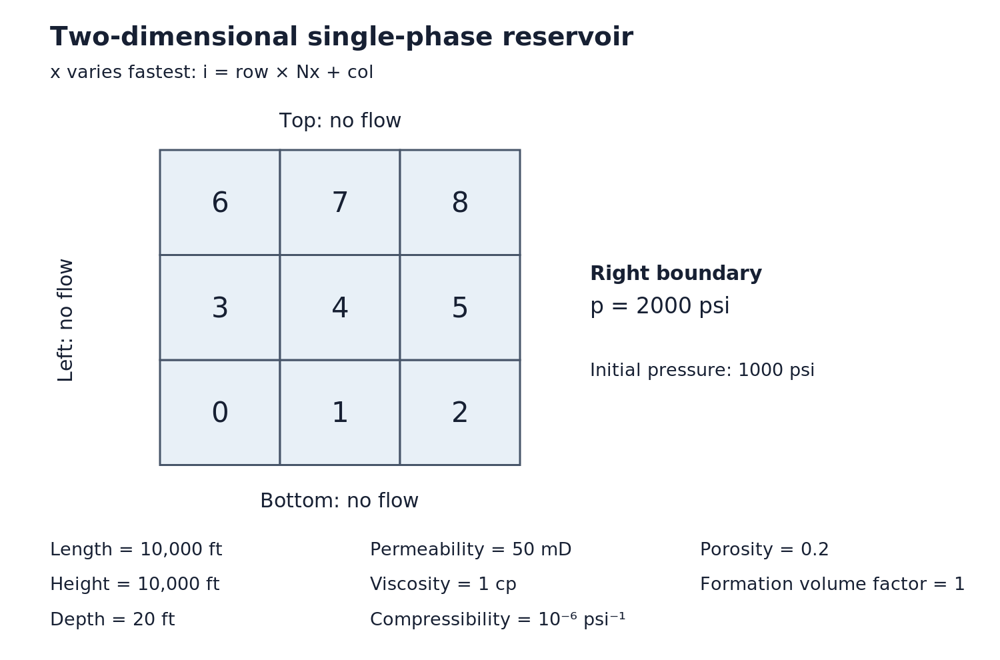

# Homework Assignment 15 — A two-dimensional reservoir simulator

[](https://github.com/PGE323M/assignment15/actions/workflows/main.yml)

Extend the single-phase simulator from [Assignment 13](https://github.com/PGE323M/assignment13)
to a two-dimensional Cartesian grid. Reuse `OneDimReservoir` through inheritance;
a one-row reservoir must still reproduce the one-dimensional results.



The illustrated example has 3 × 3 equal blocks, length and height 10,000 ft,
depth 20 ft, permeability 50 mD, porosity 0.2, water viscosity 1 cp,
compressibility 10⁻⁶ psi⁻¹, and formation volume factor 1. Initially the pressure
is 1,000 psi; the right boundary is held at 2,000 psi and the other boundaries
have no flow. Use a conversion factor of 0.00633 with these field units.
The supplied `inputs.yml` retains the one-row regression example; `test.py`
also contains the illustrated 3 × 3 case. Do not change either example's values.

## What to implement

Submit **`assignment15.py` only**. The provided `assignment13.py` is the complete
base class. Do not replace it with an earlier copy or edit its time integrator.
Input normalization and a boundary-face helper are supplied in the subclass.
Implement these three methods in `TwoDimReservoir(OneDimReservoir)`:

1. `compute_transmissibility(i, j)` — unconverted interblock conductance for
   face-sharing cells; return zero if either permeability is zero, including
   when both are zero. Preserve the legacy `i == j` convention: conductance
   across one full block in the x direction. Reject non-face neighbors.
2. `compute_accumulation(i)` — storage for a block with its own volume and porosity.
3. `fill_matrices()` — sparse transmissibility and accumulation matrices,
   `self.T` and `self.B`, and a dense length-N source vector `self.Q`.

### Grid indexing and inputs

The grid has `Nx` columns and `Ny` rows, with `N = Nx * Ny` cells. Number cells
left to right along the bottom row, then move up one row: `i = row * Nx + col`.
Left/right neighbors differ by one **only within a row**; bottom/top neighbors
differ by `Nx`. Never connect the last column of one row to the first of the next.
A one-column grid's consecutive cells are vertical neighbors.

`numerical: number of grids` supplies `x` and `y`. Optional `delta x` and `delta y`
are positive widths per column and row, respectively (length `Nx` and `Ny`);
otherwise divide reservoir `length` and `height` uniformly. Use widths that sum
to those extents. Permeability, depth, and porosity may be scalars, flat length-N
lists in cell order, or filenames containing N values. Permeability may be zero;
widths, depths, porosities, and fluid properties are positive.

The supplied parser expands these into flat length-N arrays: `delta_x`,
`delta_y`, `depth`, `permeability`, and `porosity`. In this subclass, `area` is
**plan-view area** (`delta_x * delta_y`), not the cross-sectional area used in A13.

### Face conductance and storage

For each half block, use resistance `half-width / (permeability × face area)`.
Add the two resistances in series, then divide their reciprocal by viscosity
and formation volume factor. For x flow, the width is `delta_x` and the face
area is `delta_y * depth`; for y flow, exchange x and y. When depth differs,
use each block's own face area in its half-block resistance. The result must
be symmetric when i and j are exchanged. The conversion factor does **not**
belong in `compute_transmissibility`.

Storage is block volume times porosity times compressibility divided by formation
volume factor. Volume is `delta_x * delta_y * depth`. Do not multiply storage
by the transmissibility conversion factor.

For an internal face with converted conductance t, add t to both diagonal entries
and −t to the two corresponding off-diagonal entries. Count each face once.
Store both matrices in CSR format; storage is diagonal. In a closed reservoir,
the rows of the transmissibility matrix sum to zero.

For each exposed cell face, read `left`, `right`, `bottom`, or `top` from
`boundary conditions`. A prescribed pressure acts at the exterior **face**, not
the cell center. The provided `boundary_transmissibility(i, axis)` returns the
unconverted center-to-face conductance, including the half-distance factor;
use axis `'x'` or `'y'`, and do not double it again. Add the converted conductance
to the diagonal and its product with boundary pressure to Q. Corners receive
both boundary contributions; a one-cell-wide direction has two exposed faces.
Only prescribed pressure and **zero prescribed flux** are required. Reject other
boundary types and nonzero prescribed flux rather than silently ignoring them.

The inherited time integrator solves

$$
\mathbf{B}\frac{\mathbf{p}^{n+1}-\mathbf{p}^n}{\Delta t}
+\mathbf{T}\big[(1-\theta)\mathbf{p}^{n+1}+\theta\mathbf{p}^n\big]
=\mathbf{Q}.
$$

The course convention is θ = 0 for implicit, θ = 1 for explicit, and θ = 0.5
for Crank–Nicolson. Reuse the inherited solver; do not reverse the endpoints.
Explicit time steps must be small enough for stability.

## Agent exercise — plan the extension before editing

Read `AGENTS.md`, this specification, the subclass, the base class, and tests.
Ask your agent for a bounded implementation plan **before allowing edits**:

- Identify methods that can be inherited and methods that must be overridden.
- Explain cell indexing and valid neighbors, including `Nx = 1` and `Ny = 1`.
- Identify the units, array shapes, four boundaries, and half-distance factors.
- Specify how to check 1D compatibility, 2D connectivity, and conservation.

Review the plan yourself. Challenge any proposal to copy the time solver, edit
protected tests, or change existing numerical targets. Approve the plan, then
have the agent implement one method at a time and inspect each diff.
After implementation, ask the agent to compare its changes with the approved
plan and explain the numerical evidence. You must independently inspect the diff
and rerun the tests before accepting the result. The plan is a conversation,
not an additional file to submit; no instruction-file rewrite is required.

## Testing

From the repository root:

```bash
python -m unittest -v test.py
git diff --check
```

All 16 original numerical checks are retained. Additional checks cover sparse
assembly, horizontal versus vertical neighbors, heterogeneous storage and face
resistances, impermeable cells, pressure boundaries at corners, closed-reservoir
behavior, and agreement with the A13 solver for all three time methods.
Do not weaken tests to obtain a pass. Passing tests is necessary; also inspect
units, conservation, and the absence of row-wrap connections.

## Submission

When ready, tell the agent **submit assignment 15**. It loads the supplied
submission skill, runs the protected checks, and presents a dry run. Inspect it
and explicitly approve execution before it commits and pushes `assignment15.py`.
No edits are allowed during submission. A pending or unavailable GitHub check is
not a successful check.
